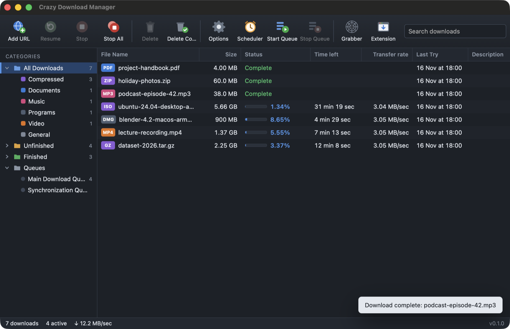
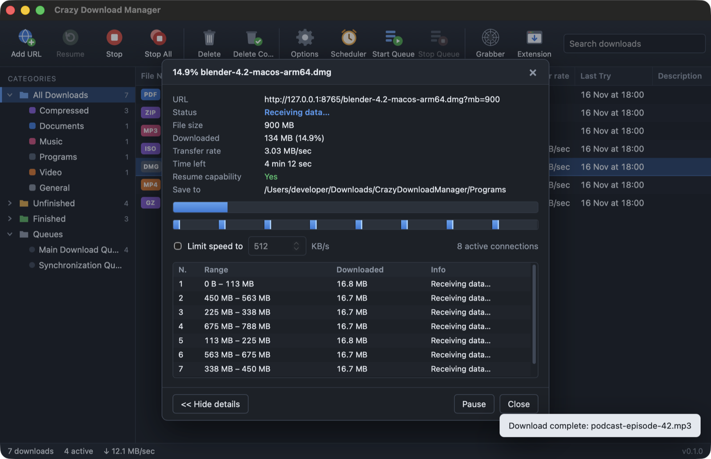
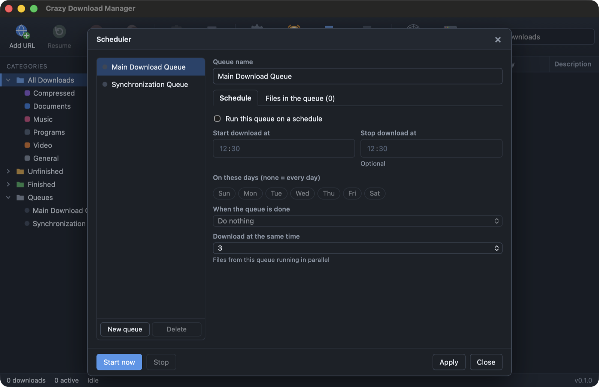
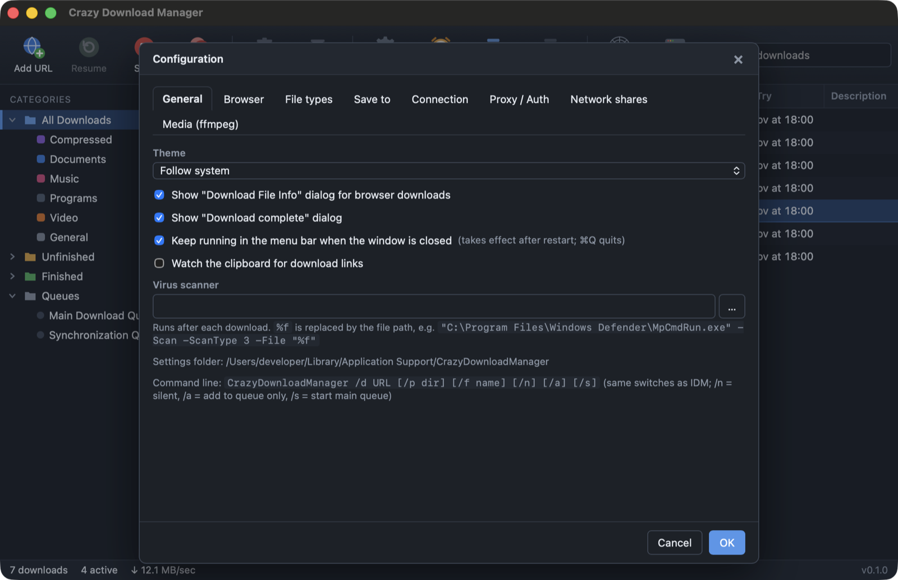

# Crazy Download Manager

[](https://github.com/mroplus/CrazyDownloadManager/actions/workflows/build.yml)

A free, open-source download accelerator for **Windows and macOS**, with a
classic download-manager interface. Written in Go with a Wails + React UI, plus
a browser extension for Chrome, Edge, Brave, Opera and Firefox.



## Features

- **Faster downloads**: up to 32 connections per file, with dynamic
  segmentation. A connection that finishes early takes over half of the
  largest piece still downloading.
- **Resume anywhere**: progress is saved every few seconds, so downloads
  survive a crash, a reboot or a dropped connection.
- **Protocols**: HTTP, HTTPS and FTP/FTPS natively. HLS, DASH, MMS, RTMP, RTSP
  and SRT through ffmpeg. YouTube, Vimeo and other video sites through yt-dlp.
- **Browser integration**: catches downloads from the browser, adds a
  "Download this video" button on pages with video, and can download all links
  on a page.
- **Queues and scheduler**: several queues, start and stop times, weekdays,
  and exit, sleep or shut down when a queue finishes.
- **Site grabber**: crawl a site for files of chosen types, or mirror it for
  offline reading.
- **Speed limits**: a global limit, plus per-download limits that can change
  while the download runs.
- **Save anywhere**: local folders, UNC paths, or straight to SMB shares
  (`smb://nas/share/folder`).
- **Tray and menu bar**: closing the window keeps downloads running in the
  Windows notification area or the macOS menu bar.
- **More**: automatic categories by file type, proxy support (HTTP, HTTPS,
  SOCKS5), Basic/NTLM/Negotiate authentication, clipboard monitoring, drag and
  drop, a virus-scan hook, light and dark themes, and an IDM-compatible
  command line.

| Download progress | Scheduler |
|---|---|
|  |  |



## Download

Get the latest build from the
[Releases page](https://github.com/mroplus/CrazyDownloadManager/releases):

| File | For |
|---|---|
| `…-windows-amd64-setup.exe` | Windows installer |
| `…-windows-amd64.zip` | Portable Windows build, with the browser extension |
| `…-macos-universal.dmg` | macOS (Apple Silicon and Intel) |
| `…-macos-universal.zip` | macOS app, with the browser extension |
| `…-extension-chromium.zip` | Browser extension only |

The builds are not code-signed yet:

- **Windows**: SmartScreen may say "Windows protected your PC". Click
  *More info* → *Run anyway*.
- **macOS**: the first time, right-click the app and choose *Open*. If macOS
  says the app is damaged, run `xattr -dr com.apple.quarantine "/Applications/CrazyDownloadManager.app"`.

Optional tools, detected automatically when they are on your `PATH` or next
to the app:

- **ffmpeg**, for streams and conversions: `winget install ffmpeg` / `brew install ffmpeg`
- **yt-dlp**, for video sites: `winget install yt-dlp` / `brew install yt-dlp`

## Browser extension

1. Unzip the extension (it is also inside the Windows and macOS zips).
2. Open `chrome://extensions` (or `edge://extensions`, `brave://extensions`,
   `opera://extensions`) and turn on **Developer mode**.
3. Click **Load unpacked** and pick the folder that contains `manifest.json`.
4. In the app, open **Options → Browser** and copy the pairing token. Paste it
   into the extension's options and click **Test connection**.

Firefox: open `about:debugging` → *This Firefox* → *Load Temporary Add-on*
and pick `manifest.json`. Then click **Allow access to all sites** in the
extension's options, because Firefox doesn't grant site access on install.

Using it:

- Clicking a link to a file type listed in *Options → File types* sends it to
  the app. Hold **Alt** while clicking to let the browser download it instead.
- Right-click a link → **Download with Crazy DM**, or right-click the page →
  **Download all links with Crazy DM**.
- Play a video, then use the **Download this video** button on the page or the
  toolbar popup.

The app only listens on `127.0.0.1`, every request needs the pairing token, and
requests from web pages are refused.

## Tray and menu bar

When **Options → General → Keep running … when the window is closed** is on
(the default), closing the window hides it and downloads keep running:

- **Windows**: the icon sits in the notification area. Left-click shows the
  window. Right-click opens a menu with the current status, *Resume all*,
  *Pause all* and *Exit*.
- **macOS**: the icon sits in the menu bar with the same menu. The Dock icon
  also brings the window back, and ⌘Q quits. Changing this option on macOS
  takes effect after a restart.

## Command line

```
CrazyDownloadManager /d URL [/p folder] [/f filename] [/n] [/a] [/s]
  /d URL      download URL (a bare URL works too)
  /p folder   save to this folder (local, UNC or smb://)
  /f name     save under this file name
  /n          silent: no dialog, start right away
  /a          add to the main queue without starting
  /s          start the main queue
```

If the app is already running, the arguments go to that instance.

## Building from source

You need Go 1.27 (any Go 1.21 or newer downloads it automatically because
`go.mod` pins the toolchain), Node 20 or newer, and the Wails CLI at the
version in `go.mod`:

```sh
go install github.com/wailsapp/wails/v2/cmd/wails@v2.17.1
wails doctor                               # checks WebView2 (Windows) or Xcode tools (macOS)

wails dev                                  # live reload
wails build                                # build/bin/CrazyDownloadManager(.exe|.app)
wails build -nsis                          # Windows installer (needs NSIS)
wails build -platform darwin/universal     # macOS, Apple Silicon + Intel

go test ./internal/...
go run ./tools/genicons                    # regenerate app, extension and tray icons
```

[GitHub Actions](.github/workflows/build.yml) builds the Windows and macOS
apps and the extension on every push. Pushing a `v*` tag that matches the
version in `app.go`, `wails.json` and the extension manifest publishes a
release.

## How it works

```
Browser extension (MV3) ──HTTP, 127.0.0.1 + token──▶ internal/bridge
                                                          │
React UI ◀──Wails events / bindings──▶ app.go ────────────┤
                                                          ▼
                                         internal/engine  Manager: queues, scheduler,
                                           segmented.go   limits, persistence
                                           source_*.go    HTTP(S), FTP(S)
                                           stream.go      ffmpeg, yt-dlp
                                         internal/storage local, UNC, smb://
                                         internal/grabber site spider
                                         internal/tray    Windows tray, macOS menu bar
```

Some design choices:

- **HTTP/2 is disabled**, because it would put every connection onto one TCP
  stream and remove the speed-up.
- **The User-Agent is honest** (`CrazyDownloadManager/x`). Some CDNs drop
  connections that claim to be Chrome but have Go's TLS fingerprint.
- **The number of connections adapts**: if a server limits connections per
  client, the extra connections hand their ranges back instead of failing.
- **Part files are sparse** on Windows, so a connection writing near the end of
  a large file doesn't force the disk to zero-fill the gap first.
- **Stopping a live stream keeps the recording playable**: ffmpeg is told to
  finish the file properly.

Settings and the download list are stored in `%APPDATA%\CrazyDownloadManager`
on Windows and `~/Library/Application Support/CrazyDownloadManager` on macOS.

## Roadmap

A multilingual UI, Kerberos single sign-on, link rewriting in mirror mode, and
signed builds.

## License

[MIT](LICENSE)
